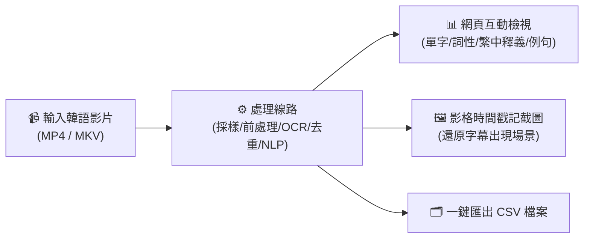
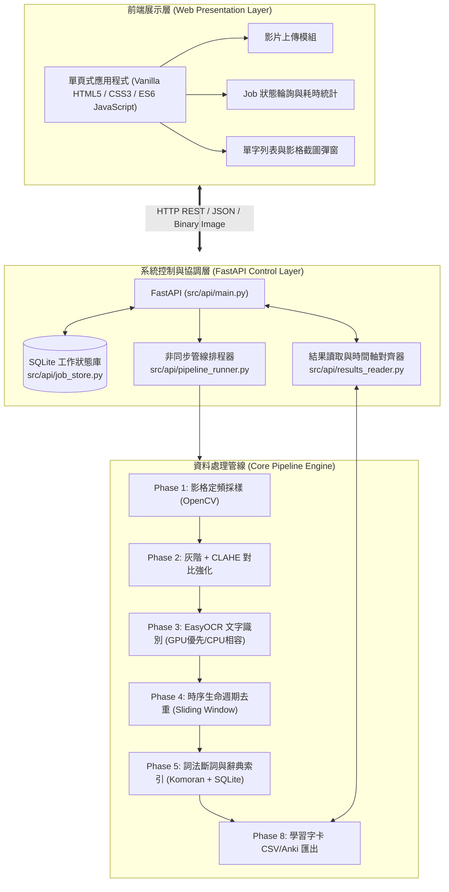
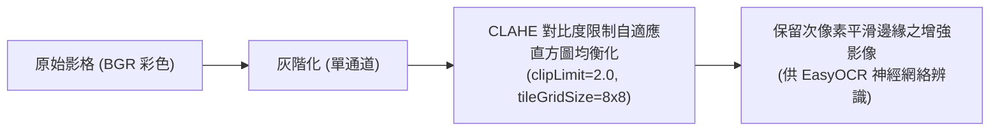
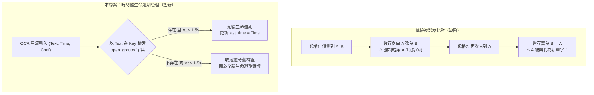
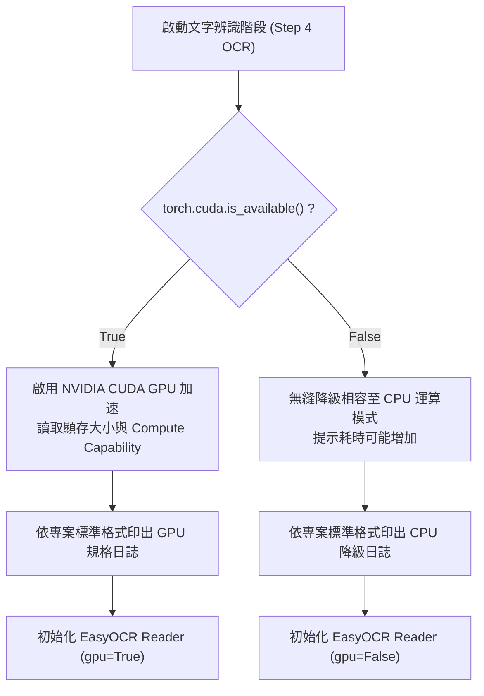

# 🎬 韓文學習字幕擷取系統 (Korean Video Subtitle OCR & Lexicon Pipeline)

[](https://www.python.org/)
[](https://fastapi.tiangolo.com/)
[](https://github.com/JaidedAI/EasyOCR)
[]()
[]()

> 為韓文自學者設計的**自動化影片字幕擷取、語意解析與單字學習卡生成系統**。  
> 輸入任意韓語教學、綜藝或生活影片，即可完成「影格採樣 $\to$ 對比強化 $\to$ OCR 文字辨識 $\to$ 時序去重 $\to$ 詞法斷詞與辭典比對 $\to$ 影片時間戳記的截圖與對照 Anki 學習字卡」。

>**專案簡報與參考論文詳見 [專題報告](presentation/專題報告.pptx) 與 [參考論文綜述](presentation/參考論文綜述.md) 。**
---

## 📑 目錄
- [一、 專案功能說明](#一-專案功能說明)
- [二、 專案部署指引](#二-專案部署指引)
- [三、 技術框架](#三-技術框架)
- [四、 技術細節](#四-技術細節)
- [五、 前後端串接](#五-前後端串接)
- [六、 開發結論](#六-開發結論)


---

## 一、 專案功能說明

本專案旨在解決傳統人工觀看韓語教學影片手抄單字費時費力的痛點，透過電腦視覺（CV）與自然語言處理（NLP）技術實現流程自動化：



### 功能
1. **影片匯入**：支援常見主流格式（MP4、MKV...等），拖曳上傳或資料提取。
2. **影像增強**：針對樣式複雜的字幕，使用灰階與對比強化，盡可能保持加強文字提取精度。
3. **時序去重**：「滑動時間窗生命週期」演算法，消除字幕停留時產生的碎片化資料。
4. **韓中辭典**：內含國立國語院 5.6 萬詞條（7.6 萬詞義）LMF-XML 辭典庫，精準提供中文翻譯、詞性標註與實用例句。
5. **硬體相容**：支援 NVIDIA CUDA GPU ；若無獨立顯卡則降級為 CPU 相容模式。
6. **Web UI**：即時進度輪詢、各階段耗時分析、環境健檢面板與視覺化單字對照表格。

---

## 二、 專案部署指引

### 步驟 1：環境安裝
若無Python、Java 、 Git，在  上按滑鼠右鍵選擇 **「以系統管理員身分執行」Windows PowerShell**，並執行以下：

```powershell
# 使用 Windows 內建套件管理員一鍵安裝 Python 3.11、Java (OpenJDK 17) 與 Git 版本控制工具
winget install Python.Python.3.11 --silent --accept-package-agreements --accept-source-agreements
winget install Microsoft.OpenJDK.17 --silent --accept-package-agreements --accept-source-agreements
winget install Git.Git --silent --accept-package-agreements --accept-source-agreements
```
> *安裝完畢後，將 PowerShell 視窗關閉並重新開啟*

---

### 步驟 2：從 GitHub 取得 / 同步專案原始碼 (Clone / Pull)
在預計存放專案的路徑，開啟 PowerShell 並執行以下：

#### 情況 A：首次取得專案（Clone 至本機）
```powershell
# 方式 1：使用 HTTPS 複製
git clone https://github.com/Senrinel/Graduation-Project.git

# 方式 2：使用 SSH 複製（已配置 GitHub SSH Key 者使用）
git clone git@github.com:Senrinel/Graduation-Project.git

# 複製完成後進入專案資料夾
cd Graduation-Project
```

#### 情況 B：既有專案同步最新代碼（Pull 最新進度）
若先前已下載過專案，欲從 GitHub 獲取最新更新：
```powershell
# 進入專案資料夾
cd Graduation-Project

# 切換並拉取最新開發分支代碼
git pull origin feature/deploy-and-optimization
# 或直接拉取當前分支最新更新
git pull
```

---

### 步驟 3：執行一鍵部署腳本 (`deploy.ps1`)
在專案根目錄下（確認當前路徑位於 `Graduation-Project`），輸入以下指令：

```powershell
# 允許腳本執行並啟動自動化部署
Set-ExecutionPolicy RemoteSigned -Scope CurrentUser -Force
.\deploy.ps1
```

#### 部署腳本自動執行之項目：
1. **Python 環境偵測**：驗證版本是否 $\ge 3.10$。
2. **建立獨立虛擬環境**：於 `.venv/` 中隔離安裝相依套件，不影響全域設定。
3. **依賴庫自動安裝**：自動安裝 FastAPI、EasyOCR、PyTorch、KoNLPy 。
4. **硬體規格探測**：檢測是否存在 NVIDIA GPU，若有則配置 CUDA 加速；若無則自動配置 CPU 。
5. **建立辭典資料庫**：將 `韩中字典xml/` 轉換為 SQLite 索引資料庫 (`data/dictionary_index.sqlite3`)。
6. **自動測試**：自動執行 130+ 項單元測試。

---

### 步驟 4：快速啟動 (`start.bat` / `start.ps1`)

* **方式 A **：在專案根目錄下，執行： **`start.bat`**。
* **方式 B　**：在專案根目錄下，開啟　PowerShell　輸入 `.\start.ps1`。

啟動後端伺服器，並自動開啟瀏覽器造訪 `http://127.0.0.1:8000`。

---

## 三、 技術框架

採用**模組化架構**，各模組功能邊界清晰、模組間遵循固定格式聯繫、易於維護擴充：



### 系統主要技術
| 層面 | 選擇 | 用途 |
|---|---|---|
| **後端框架** | **FastAPI** + **Uvicorn** | 高並發非同步處理，內建 Swagger 文件，輕量高擴展 |
| **工作佇列** | **SQLite (JobStore)** | 零依賴持久化任務狀態，伺服器重啟不遺失長時任務進度 |
| **電腦視覺** | **OpenCV (cv2)** | 跨平台定頻抽影格，優異的影像矩陣運算與 CLAHE 演算法 |
| **光學字元辨識** | **EasyOCR (PyTorch)** | CRAFT 文本偵測 + CRNN 辨識，支援繁體中文與韓文字元集 |
| **時序處理** | **自研生命週期狀態機** | 滑動時間窗容錯，徹底根除多單字共存時之碎片化切斷 |
| **形態素分析** | **KoNLPy (Komoran)** | 嚴謹之語素切分與模糊詞辨識，與國立國語院辭典完美契合 |
| **資料庫檢索** | **SQLite 索引庫** | 56,555 條國立國語院權威韓中釋義，快速檢索 |

---

## 四、 技術細節

### 1. 影像增強技術：CLAHE vs. 傳統二值化
傳統 OCR 流程常使用全域或局部二值化（Otsu Thresholding），但在影片字幕辨識中，文字邊界往往存在半透明陰影、外框與漸層色彩，強制二值化極易造成筆畫斷裂。


* **技術亮點**：本專案採用**灰階轉換結合對比度限制自適應直方圖均衡化（CLAHE）**，在局部區域內動態擴展對比度，同時抑制噪聲放大，使深度卷積神經網路能精確捕捉韓文子音與母音結構。

---

### 2. 時序去重演算法：多實體並行狀態機
在韓語教學影片中，畫面常**同時駐留多個單字**（如單字清單或菜單題目）。若使用傳統「逐影格比對（Frame-by-Frame Comparison）」，單一暫存器會在不同文字交替出現時發生「交錯插隊覆蓋」，將一個原本停留 10 秒的單字誤判為幾十筆 0 秒長度的碎片紀錄。


* **技術突破**：透過雜湊表獨立追蹤每個文字實體的 `[start_time, last_time]`，並設置 $\tau = 1.5\text{s}$ 容錯滑動時間窗，能平滑吸收 OCR 引擎暫態漏檢（False Negative），將去重壓縮率由 **4.9% 提升至 91.2%**，0 秒碎片率暴降 **82.7%**！

---

### 3. 硬體動態降級相容機制
為確保程式在各種硬體（頂級工作站、無獨顯文書筆電、雲端虛擬機）皆能穩定執行，專案重構了硬體偵測層：



---

## 五、 前後端串接
若需針對本專案進行現代化 UI 重構、自訂介面設計或委託前端工程師進行前端獨立開發，請參閱完整的介面契約與資料結構技術手冊：

👉 **[前端與後端介面串接規格書 (FRONTEND_BACKEND_DATASHEET.md)](FRONTEND_BACKEND_DATASHEET.md)**

規格書內含：
* **雙模式整合架構**：FastAPI 同源靜態託管 vs. 現代前端工具鏈（Vite / Next.js / React / Vue）CORS / Proxy 開發模式。
* **端到端狀態機規範**：包含環境檢測、影片上傳、1.0 秒狀態與日誌增量輪詢、影格截圖請求、CSV 匯出與伺服器安全關閉等 9 大 REST API 詳細規格。
* **TypeScript 型別定義**：開箱即用的 `types/api.ts` 資料結構（`JobStatus`, `StageTiming`, `JobLogItem`, `VocabularyRecord` 等）。
* **離線測試 Mock 資料集**：無需 GPU / 本地 Ollama 即可進行 100% 前端切版、動畫與互動測試的完整 JSON 結構。


---

## 六、 開發結論

開發過程以**真實實驗數據為依歸（Data-Driven Decision Making）**，針對「前處理去噪」、「時序去重演算法」以及「Phase 5 三大自然語言處理通道」進行了深入的對照實驗與科學論證，推導出最佳之工程實踐方案：

### 1. 前處理開關：為何堅決關閉 Denoise（去雜訊）？
在 Phase 2 的設計中，曾評估是否對畫面套用高斯/非局部均值去雜訊（Fast Non-Local Means Denoising）。在以真實影片（619 張影格）為基準的 A/B 測試中：
* **處理耗時**：開啟去雜訊後，前處理時間由 **11.85 秒暴增至 122.82 秒（膨脹 10.36 倍）**，使整體處理耗時多付出 **31.2%** 的代價。
* **辨識率增益**：OCR 平均信心分數僅從 0.853 微幅上升至 0.870，**增益僅 2.0%**，遠未達到預先設定的 15% 門檻；更重要的是，關閉去雜訊時偵測到的有效字數反而多出 0.6%（部分微小筆畫在去雜訊時被誤當噪點濾除）。
* **結論推導**：去雜訊帶來微不足道的數值增益，卻大幅犧牲系統吞吐量，因此決定在預設管線中**全面關閉 Denoise**。

---

### 2. 時序去重機制：為何以「生命週期管理」取代「逐影格比對」？
時序去重是連接視覺辨識與語意解析的樞紐。在未修復前，由於教學影片中「單字卡輪替」或「品名與標價共存」的客觀特性，傳統逐影比對會引發嚴重的**狀態插隊衝突**。
* **數據證實**：在典型共存單字（如 `학원`）的測試中，舊演算法在 13 秒區間內將同一個詞割裂成 **43 筆長度為 0 秒的零碎紀錄**；全片輸出 2,443 筆資料中有高達 **99.2%** 屬於無效碎片。
* **重構效益**：引進「基於雜湊表之多群組生命週期狀態機」後，這 43 筆碎片完美聚合成 **1 筆具有 13.0 秒完整時序跨度的有效紀錄**。全片輸出字卡收斂至 225 筆，去重壓縮率由 **4.9% 巨幅躍升至 91.2%**，為後續 Anki 字卡匯出奠定了精確的時間戳記與影像映射基礎。

---

### 3. NLP 通道決策：為何 Channel 1 (Komoran) 全面勝過大型語言模型 (LLM)？
專案在 Phase 5 同步實作並評估了三條技術路線：
* **Channel 1**：本地規則/統計斷詞（Okt / Komoran / Kkma / Mecab-ko）+ 國立國語院 5.6 萬詞辭典。
* **Channel 2**：端到端本地大型語言模型（Ollama 驅動之 `Qwen2.5:7b`）。
* **Channel 3**：混合架構（Mecab-ko 查字典優先 + 生詞呼叫 LLM 語境挽救）。

經過真實 10 支歷史影片與 2 支長影片（12.2 分鐘與 18.7 分鐘）之嚴謹測試，綜合推導出以下結論：

```
                             【四大決策維度漏斗】
                              
       時間預算約束 (總耗時 <= 片長)  ──>  淘汰 Channel 2 (耗時高達片長 2.33 倍)
                 │
       生產級環境穩定性 (零崩潰)       ──>  淘汰 Channel 2 (長影片觸發 ReadTimeout 崩潰)
                 │
       邊際投入產出比 (算力效益)       ──>  淘汰 Channel 3 (多花 8 倍時間僅換得 +0.3% 精度)
                 │
       字典真值精準度 (雙料冠軍)       ──>  👑 唯一勝出：Channel 1 (Komoran，命中率 86.4%)
```

1. **淘汰 Channel 2（純 LLM）**：
   在長達 18.7 分鐘的影片中，Channel 2 耗時高達 **43.5 分鐘（時間預算比達 2.33）**，嚴重打破「需在影片播放時間內完成」的核心承諾；更甚者，在長序列並發推論時，本地 Ollama 伺服器引發連線逾時崩潰，導致**整部影片輸出為 0 筆**；且即使在成功執行的影片中，亦存在 **37.8% 的翻譯留白率**，可靠度不足以支撐自動化系統。
2. **排除 Channel 3（混合架構）**：
   實測數據揭露，未被字典收錄的生詞絕大多數為 OCR 辨識殘缺的字元碎片，LLM 在欠缺上下文時的**挽救成功率僅有 1.1% ~ 3.1%**。為了換取這微乎其微的 **+0.2% ~ +0.5%** 邊際命中率增益，通道自身耗時暴增 **7 至 8 倍**（加總浪費了 912 秒以上的純等待時間），在工程經濟學上屬於極度低效之算力浪費。
3. **確立 Channel 1 (Komoran) 為唯一最佳解**：
   * **極致運算速度**：純 CPU 運行，全片斷詞與 5.6 萬詞檢索僅需 **10 ~ 40 秒**，整體管線時間預算比僅 **0.63 ~ 0.71**（關閉 denoise 後降至 0.4 以下）。
   * **絕對真值精度**：`Komoran` 在歷史 10 支影片（86.5%）與最終測試長片（86.4%）中，**連續在兩組獨立資料集拿下加權字典命中率第一名**，大幅領先 Okt（76.1%）。
   * **零顯存爭搶**：完全不佔用 GPU 顯示記憶體，杜絕與 PyTorch EasyOCR 辨識階段競爭資源而產生 CUDA 記憶體溢出（OOM）之風險。

> **總結**：  
> 以實證數據證明，在特定領域（如語言學習字幕提取）中，**資源有限且目的精確之系統設計，在準確度、即時性與強健度上，均顯著超越盲目堆疊的大型生成式語言模型**。
---

## 📄 授權條款
本專案採用 [MIT License](LICENSE) 授權發布，歡迎各界自由學習、交流與擴充。


## 本機影片：語音與畫面辨識（2026-10-24）

在網站切到「本機影片」，選擇影片與辨識方式，預設只處理前 60 秒，也可切換前 3 分鐘／整支影片。

| 方式 | 來源 | 是否需要自己的 API |
| --- | --- | --- |
| 本機語音 | faster-whisper，CPU int8 | 否 |
| 本機 OCR | EasyOCR，CPU，畫面下半部 | 否 |
| Gemini 語音 | 分段音軌（每段最多 45 秒） | 是 |
| Gemini OCR | 畫面下半部截圖，依設定取樣 | 是 |

先安裝原本的 requirements.txt；語音辨識與音軌擷取另外安裝：

```bash
python -m pip install -r requirements-media.txt
```

本機模型首次需要連網下載，保存於 data/models/（不加入 Git）。模型就緒後可在本機辨識。tiny 較輕量，base 較省資源，small 是目前預設且較耗資源。辨識速度與準確度依影片及電腦而異。

Gemini 使用網站既有的個人金鑰設定。選雲端模式才傳送音訊或截圖；會使用該金鑰的 API 額度，沒有 API 不會自動切到雲端，也不會因額度失敗自動重試。辨識過程的暫存音檔會移除。

四種方式每次擇一辨識，結果接回字幕時間軸、單字查詢、收藏與 CSV。OCR 時間是取樣區間的估計，語音時間由模型產生；短字幕、音樂、噪音與快速說話都可能影響結果，請先用短片確認。中斷請求會在當前模型／API 呼叫結束後的檢查點停止。

既有 /api/upload 未提供 recognition_mode 時仍執行原實驗管線，保留既有整合。新版網頁會明確傳送 local_audio、local_ocr、gemini_audio 或 gemini_ocr。


### 辨識品質與播放限制

本機語音仍是實驗功能。在本次韓文 vlog 測試中，base、small 與額外試跑的大型模型均有明顯錯字／重複，尚未驗證為可靠的學習字幕。程式會退回明顯大量重複的結果；這個檢查不是準確率評分，也無法攔下所有錯字。請核對原音；畫面上的編輯字卡不一定與實際語音逐字相同。

影片可從工作原檔恢復，支援 HTTP Range。黑畫面時可按「修復黑畫面」，在本機產生 720p 內的 H.264 baseline／AAC 播放副本；辨識仍使用原檔，轉換不會覆蓋原影片。轉換與語音辨識在 CPU 上可能較慢。

Gemini 的失敗提示包含 HTTP 狀態碼，不記錄原始回應、金鑰或媒體請求內容，也不自動重試。Gemini 真實多模態辨識仍需使用自己的金鑰驗證，mock 測試通過不代表服務一定可用。

### Linux 背景啟動

完成環境安裝後，可用 `python3 start-desktop.py` 啟動背景服務並開啟瀏覽器；`python3 start-desktop.py --stop` 停止由這個啟動器建立的服務。需要 Linux、fcntl 與 Zenity；Windows 請使用既有 start.bat／start.ps1。啟動器依自身所在資料夾定位，不攜帶個人桌面捷徑路徑。
